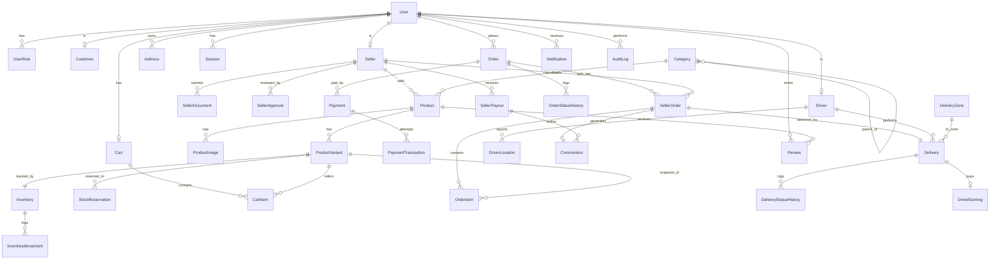

# Agroconet — Base de Dados (Fase 0)

> Proposta de modelo lógico. O `schema.prisma` completo é escrito na Fase 2, depois de aprovares isto.

---

## 1. Convenções

| Tema | Regra |
|---|---|
| Chaves primárias | `UUID` (v7 se disponível, para melhor localidade de índice); `id` em todas as tabelas |
| Timestamps | `created_at`, `updated_at` (todas); `deleted_at` (soft delete, só onde indicado) |
| Dinheiro | `INTEGER`/`BIGINT` em **centavos de MZN**; coluna `currency` (`MZN`) onde houver pagamentos |
| Percentagens | pontos-base inteiros (`bps`; 1000 = 10%) |
| Nomes | tabelas em `snake_case` plural, mapeadas no Prisma; enums em `SCREAMING_SNAKE_CASE` |
| Enums | Para estados fechados (estados de encomenda, papéis…). Listas editáveis pelo admin (categorias, zonas) são **tabelas**, não enums |
| Snapshots | `OrderItem` guarda nome, SKU, preço unitário e comissão no momento da compra |
| Integridade | FKs sempre; `ON DELETE RESTRICT` por defeito (dados financeiros nunca em cascata); `CASCADE` só em dependentes puros (ex.: imagens de um produto) |
| Soft delete | `User`, `Seller`, `Product`, `ProductVariant`, `Category`, `Address`, `Driver`. **Nunca** em Order, Payment, InventoryMovement, AuditLog (imutáveis) |
| Imutáveis | `InventoryMovement`, `AuditLog`, `*StatusHistory`, `PaymentTransaction`, `WebhookEvent`: apenas INSERT |

---

## 2. Reconciliação com a lista de entidades do briefing

| Entidade do briefing | Decisão | Motivo |
|---|---|---|
| `User`, `Customer`, `Seller`, `Driver` | **Mantidas**; `User` = identidade; `Customer/Seller/Driver` = perfis | Uma pessoa pode ser cliente e vendedor |
| `Role` | **Enum `Role` + tabela `UserRole`** (N:N) em vez de tabela `Role`. Permissões definidas em código tipado (`config/permissions.ts`) | 5 papéis fixos; tabela de permissões editável traz complexidade sem necessidade |
| `Subcategory` | **Fundida em `Category`** (auto-relação `parent_id`) | Evita duas tabelas iguais; permite mais níveis |
| `OrderStatus`, `DeliveryStatus` | **Enums + tabelas de histórico** (`OrderStatusHistory`, `DeliveryStatusHistory`) | Estados são código (máquina de estados), não dados |
| `PaymentMethod` | **Enum** (`MPESA`, `EMOLA`, `CARD`, `COD`, `MOCK`) + configuração em `SystemSetting` | Fixos por provider |
| `SellerApproval` | **Mantida** como histórico de decisões (motivo, revisor) | Auditoria clara |
| `SellerDocument`, `DriverDocument` | **Mantidas**, separadas | Evita FK polimórfica |
| `Inventory` + `InventoryMovement` | **Mantidas**, ligadas a `ProductVariant` | Stock por variante |
| `Promotion` | **Adiada** (pós-MVP) | Complexidade de preços |
| `Coupon` | **Incluída mas simples** (fase posterior ao checkout base) | |
| **Acrescentadas** | `SellerOrder`, `ProductVariant`, `StockReservation`, `PaymentTransaction`, `WebhookEvent`, `DeliveryZone`, `DeliveryStatusHistory`, `DriverEarning`, `DriverPayout`, `Favorite`, `CheckoutSession`, `OtpChallenge`, `Session`/`Account` (auth), `NotificationPreference`, `ProductSlugHistory`, `OrderStatusHistory` | Necessárias para os requisitos do briefing |

Tabelas de filas (pg-boss) vivem no seu próprio *schema* `pgboss`, geridas pela biblioteca.

---

## 3. Diagrama de relações (núcleo)



---

## 4. Entidades por módulo

Legenda: **PK** chave primária · **FK** chave estrangeira · **UQ** único · **IX** índice.
Só se indicam campos relevantes para decisões; o restante é óbvio.

### 4.1 Identidade e acesso

**User** — `id`, `phone` (UQ, E.164, principal), `email` (UQ parcial, opcional), `password_hash` (Argon2id, nullable se só OTP), `name`, `status` (`ACTIVE`, `SUSPENDED`), `phone_verified_at`, `email_verified_at`, `last_login_at`, `deleted_at`.
- IX: `status`; UQ em `phone` e em `lower(email)` onde não nulo.

**UserRole** — `user_id` FK, `role` enum, `granted_by` FK User, `created_at`. PK composta `(user_id, role)`.

**Session / Account / Verification** — tabelas exigidas pela biblioteca de autenticação escolhida (D2); ficam fixadas na Fase 3.

**OtpChallenge** — `id`, `phone`, `code_hash`, `purpose`, `expires_at`, `attempts`, `consumed_at`. IX `(phone, created_at)`. Código nunca em claro.

**Customer** — `user_id` (UQ FK), preferências, `default_address_id`.

**Address** — `id`, `user_id` FK, `label`, `recipient_name`, `phone`, `province`, `district`, `neighborhood`, `street`, `reference` (texto livre: "ao lado da escola…"), `latitude`, `longitude` (nullable), `zone_id` FK DeliveryZone (nullable), `is_default`, `deleted_at`.
- Endereços informais são a norma: `reference` + coordenadas são mais importantes que rua/número.

### 4.2 Vendedores

**Seller** — `id`, `user_id` (UQ FK), `business_name`, `legal_name`, `tax_id` (NUIT, nullable), `description`, `logo_url`, `phone`, `province`, `district`, `address_text`, `latitude`, `longitude`, `status` (`PENDING`, `APPROVED`, `REJECTED`, `SUSPENDED`), `commission_bps_override` (nullable), `pickup_zone_id` FK, `slug` (UQ), `rating_avg`, `rating_count` (denormalizados), `approved_at`, `deleted_at`.
- IX: `status`; UQ `slug`.

**SellerDocument** — `id`, `seller_id` FK, `type`, `storage_key` (privado), `status`, `reviewed_by`, `reviewed_at`.

**SellerApproval** — `id`, `seller_id` FK, `decision` (`APPROVED`/`REJECTED`/`SUSPENDED`/`REINSTATED`), `reason`, `reviewer_id` FK User, `created_at`. Regra no service: `reviewer_id != seller.user_id`.

### 4.3 Catálogo

**Category** — `id`, `parent_id` FK (nullable), `name`, `slug` (UQ), `description`, `image_url`, `sort_order`, `is_active`, `requires_review` (categorias reguladas), `default_commission_bps` (nullable), `deleted_at`.
- IX: `(parent_id, sort_order)`.

**Product** — `id`, `seller_id` FK, `category_id` FK, `name`, `slug` (UQ), `description`, `brand`, `status` (`DRAFT`, `PENDING_REVIEW`, `ACTIVE`, `REJECTED`, `INACTIVE`, `ARCHIVED`), `rejection_reason`, `reviewed_by`, `reviewed_at`, `rating_avg`, `rating_count`, `search_vector` (`tsvector`, coluna gerada), `deleted_at`.
- IX: `(status, category_id)`, `(seller_id, status)`, GIN em `search_vector`, GIN trigram em `name`.

**ProductVariant** — `id`, `product_id` FK, `sku` (UQ), `label` ("Saco 25 kg"), `unit` enum (`KG`, `G`, `L`, `ML`, `BAG`, `UNIT`, `BOX`…), `unit_size`, `price_cents`, `compare_at_price_cents` (nullable), `is_default`, `is_active`, `low_stock_threshold`, `deleted_at`.
- `CHECK (price_cents > 0)`; UQ parcial `(product_id) WHERE is_default`.

**ProductImage** — `id`, `product_id` FK (CASCADE), `storage_key`, `alt`, `sort_order`, `is_primary`.

**ProductSlugHistory** — `slug` (UQ), `product_id`; para redirects 301.

**Favorite** — PK composta `(user_id, product_id)`.

**Review** — `id`, `user_id`, `product_id`, `seller_id`, `order_item_id` (UQ: uma avaliação por item comprado), `rating` (1–5, `CHECK`), `comment`, `status` (`PUBLISHED`, `HIDDEN`).
- Só quem comprou (item `DELIVERED`) pode avaliar. Médias atualizadas pelo worker/service.

### 4.4 Stock

**Inventory** — `variant_id` (PK/FK, 1:1), `quantity_on_hand`, `quantity_reserved`, `updated_at`.
- `CHECK (quantity_on_hand >= 0)`, `CHECK (quantity_reserved >= 0)`, `CHECK (quantity_reserved <= quantity_on_hand)` — **constraints SQL em migration manual** (Prisma não as declara).
- Disponível = `on_hand - reserved`.

**InventoryMovement** (imutável) — `id`, `variant_id` FK, `type` (`IN`, `OUT`, `SALE`, `RETURN`, `ADJUSTMENT`, `CANCELLED_ORDER`), `quantity` (com sinal), `balance_after`, `reason`, `reference_type`/`reference_id` (ex.: `ORDER`), `actor_user_id`, `created_at`.
- IX: `(variant_id, created_at)`.
- Regra: **toda** alteração de `Inventory` passa por `InventoryService.move()`, que atualiza o saldo e insere o movimento **na mesma transação**.

**StockReservation** — `id`, `variant_id`, `order_id`/`checkout_session_id`, `quantity`, `status` (`ACTIVE`, `CONSUMED`, `RELEASED`, `EXPIRED`), `expires_at`.
- IX: `(status, expires_at)` para o job de expiração.

**Como se evita sobrevenda** (atómico, sem *read-modify-write* na aplicação):

```sql
UPDATE inventory
   SET quantity_reserved = quantity_reserved + :qty
 WHERE variant_id = :id
   AND quantity_on_hand - quantity_reserved >= :qty;
-- 0 linhas afetadas → stock insuficiente
```

### 4.5 Carrinho e checkout

**Cart** — `id`, `user_id` (UQ FK nullable), `anonymous_token` (UQ nullable), `expires_at`. Sem preços guardados.
**CartItem** — `id`, `cart_id`, `variant_id`, `quantity` (`CHECK > 0`). UQ `(cart_id, variant_id)`.
**CheckoutSession** — `id`, `user_id`, `cart_snapshot` (JSON), `address_id`, `delivery_option`, `payment_method`, `step`, `expires_at`. Permite retomar e servir de âncora à idempotência.

### 4.6 Encomendas

**Order** — `id`, `number` (UQ, legível: `AGC-2026-000123`), `customer_id`/`user_id` FK, `status`, `subtotal_cents`, `delivery_total_cents`, `discount_cents`, `total_cents`, `currency`, `shipping_address_snapshot` (JSON — cópia do endereço no momento), `contact_phone`, `idempotency_key` (UQ), `placed_at`, `cancelled_at`, `cancel_reason`.
- IX: `(user_id, created_at desc)`, `(status, created_at)`.

**SellerOrder** — `id`, `order_id` FK, `seller_id` FK, `status`, `subtotal_cents`, `delivery_fee_cents`, `commission_cents`, `seller_net_cents`, `confirmed_at`, `ready_at`, `rejection_reason`. UQ `(order_id, seller_id)`.
- IX: `(seller_id, status, created_at desc)`.

**OrderItem** — `id`, `seller_order_id` FK, `variant_id` FK, `product_name`, `variant_label`, `sku`, `unit_price_cents`, `quantity`, `line_total_cents`, `commission_bps`, `commission_cents`.

**OrderStatusHistory** / **DeliveryStatusHistory** (imutáveis) — `entity_id`, `from_status`, `to_status`, `actor_user_id`, `note`, `created_at`.

### 4.7 Pagamentos

**Payment** — `id`, `order_id` FK, `provider`, `method`, `status` (`INITIATED`, `PENDING`, `PENDING_COLLECTION`, `PAID`, `FAILED`, `CANCELLED`, `REFUNDED`, `PARTIALLY_REFUNDED`), `amount_cents`, `currency`, `idempotency_key` (UQ), `provider_reference` (UQ por provider), `paid_at`, `failure_code`, `metadata` (JSON sem dados sensíveis).
**PaymentTransaction** (imutável) — `id`, `payment_id`, `type` (`CHARGE`, `REFUND`), `status`, `amount_cents`, `provider_transaction_id`, `raw_response` (JSON, sem segredos), `created_at`.
**WebhookEvent** — `id`, `provider`, `event_id`, `signature_valid`, `payload`, `received_at`, `processed_at`, `status`. UQ `(provider, event_id)`.
**PaymentMethod (configuração)** — via `SystemSetting`, não tabela.

### 4.8 Logística

**DeliveryZone** — `id`, `name`, `province`, `districts/neighborhoods` (array/JSON), `base_fee_cents`, `is_active`, `polygon` (nullable; preparado para geografia futura).
**Driver** — `id`, `user_id` (UQ), `vehicle_type` (`MOTORCYCLE`, `CAR`, `BICYCLE`, `ON_FOOT`), `plate`, `status` (`PENDING`, `ACTIVE`, `SUSPENDED`), `availability` (`OFFLINE`, `AVAILABLE`, `BUSY`), `deleted_at`. N:N com zonas via `DriverZone`.
**DriverDocument** — como `SellerDocument`.
**Delivery** — `id`, `seller_order_id` (UQ FK), `driver_id` (nullable), `status`, `pickup_address_snapshot`, `dropoff_address_snapshot` (JSON), `zone_id`, `fee_cents`, `driver_fee_cents`, `confirmation_code_hash`, `confirmation_method`, `proof_photo_key`, `signature_key`, `assigned_at`, `accepted_at`, `picked_up_at`, `delivered_at`, `failed_reason`, `attempts`.
- IX: `(status, zone_id)`, `(driver_id, status)`.
**DriverLocation** — `id`, `driver_id`, `delivery_id` (nullable), `latitude`, `longitude`, `recorded_at`. **Criada mas sem uso no MVP.** Particionável por tempo no futuro.
**DriverEarning** — `id`, `driver_id`, `delivery_id` (UQ), `amount_cents`, `status` (`PENDING`, `PAID`), `payout_id`.
**DriverPayout** — `id`, `driver_id`, `period_start`, `period_end`, `total_cents`, `status`, `paid_at`, `reference`.

### 4.9 Comissões e pagamentos a vendedores

**Commission** — `id`, `seller_order_id` (UQ), `seller_id`, `gross_cents`, `commission_cents`, `net_cents`, `status` (`PENDING`, `AVAILABLE`, `PAID_OUT`, `REVERSED`), `available_at` (fim do período de retenção), `payout_id`.
**SellerPayout** — `id`, `seller_id`, `total_cents`, `status`, `method`, `reference`, `paid_at`, `created_by`.
- Reembolsos/cancelamentos geram `Commission.status = REVERSED` (nunca se apaga).

### 4.10 Notificações

**Notification** — `id`, `user_id`, `type` (evento), `title`, `body`, `data` (JSON), `read_at`, `created_at`. IX `(user_id, read_at, created_at desc)`.
**NotificationDelivery** — `id`, `notification_id`, `channel` (`IN_APP`, `SMS`, `EMAIL`, `PUSH`, `WHATSAPP`), `status`, `attempts`, `provider_message_id`, `error`, `sent_at`. UQ para deduplicação.
**NotificationPreference** — `(user_id, channel, type)` → `enabled`.

### 4.11 Promoções (faseado)

**Coupon** — `code` (UQ), `type`, `value`, `min_order_cents`, `starts_at`, `ends_at`, `max_uses`, `used_count`, `per_user_limit`. `Promotion`: adiada.

### 4.12 Sistema

**AuditLog** (imutável) — `id`, `actor_user_id` (nullable para sistema), `actor_role`, `action` (`USER_LOGIN`, `PRODUCT_PRICE_CHANGED`…), `entity_type`, `entity_id`, `before` (JSON, campos relevantes), `after`, `ip`, `user_agent`, `request_id`, `created_at`.
- IX: `(entity_type, entity_id, created_at)`, `(actor_user_id, created_at)`, `(action, created_at)`.
- Retenção definida (ex.: 24 meses online, depois arquivo). Não guardar segredos nem dados de pagamento.

**SystemSetting** — `key` (UQ), `value` (JSON), `description`, `updated_by`, `updated_at`. Exemplos: contactos da empresa, taxa de comissão padrão, aprovação de produtos, tempo de reserva de stock, método de confirmação de entrega, retenção de comissões.

---

## 5. Máquinas de estado (resumo)

Transições permitidas ficam **num único ficheiro por entidade** (`services/<x>/state-machine.ts`) com testes unitários. Nada altera `status` diretamente.

| Entidade | Estados | Transições |
|---|---|---|
| **Order** | `PENDING`, `CONFIRMED`, `PROCESSING`, `PARTIALLY_DELIVERED`, `DELIVERED`, `CANCELLED` | `PENDING→CONFIRMED` (pagamento ok/COD aceite) · `CONFIRMED→PROCESSING` · `PROCESSING→PARTIALLY_DELIVERED→DELIVERED` · `PENDING/CONFIRMED/PROCESSING→CANCELLED` |
| **SellerOrder** | `PENDING`, `CONFIRMED`, `REJECTED`, `READY_FOR_PICKUP`, `PICKED_UP`, `DELIVERED`, `CANCELLED` | `PENDING→CONFIRMED/REJECTED` · `CONFIRMED→READY_FOR_PICKUP` · `READY_FOR_PICKUP→PICKED_UP→DELIVERED` · pré-`PICKED_UP→CANCELLED` |
| **Delivery** | `UNASSIGNED`, `ASSIGNED`, `ACCEPTED`, `EN_ROUTE_TO_PICKUP`, `PICKED_UP`, `EN_ROUTE_TO_CUSTOMER`, `DELIVERED`, `FAILED`, `CANCELLED` | linear; `ASSIGNED→UNASSIGNED` (recusa); `EN_ROUTE_TO_CUSTOMER→FAILED` |
| **Payment** | ver 4.7 | `INITIATED→PENDING→PAID/FAILED` · `PAID→REFUNDED/PARTIALLY_REFUNDED` |

> Nota sobre o briefing: a lista única (`PENDING … REFUNDED`) mistura estados de encomenda, entrega e pagamento. Separá-los evita estados impossíveis (ex.: encomenda "PICKED_UP" quando só um dos vendedores foi recolhido). `REFUNDED` passa a ser estado de **Payment**.

---

## 6. Performance e índices

- Listagens de produtos: índice composto `(status, category_id)` + paginação; contagens de avaliações e médias **denormalizadas** (atualizadas por service/job) para evitar `AVG()` por listagem.
- Evitar N+1: queries com `include`/`select` explícitos, `DataLoader`-style só quando necessário; revisão de queries na Fase 15 com `EXPLAIN ANALYZE`.
- Painéis: agregações por período através de queries SQL dedicadas (e vistas materializadas se necessário), nunca a carregar linhas para somar no Node.
- Pesquisa: `tsvector` com configuração `portuguese` + `unaccent` + `pg_trgm`.
- `AuditLog`, `Notification`, `InventoryMovement`, `DriverLocation` crescem depressa: índices por tempo e plano de arquivo/partição.

## 7. Seed (apenas desenvolvimento)

`prisma/seed` só corre com `NODE_ENV=development`, cria: super admin, admin, 3–4 vendedores (um deles "Agroconet"), 2 entregadores, 5 clientes, categorias reconciliadas, ~40 produtos com variantes e stock, zonas (Maputo, KaTembe, Matola), algumas encomendas em vários estados. Todos os registos com prefixo/etiqueta `[DEV]` e palavras-passe de desenvolvimento fora do `.env.example`. **Nunca** executar seed em produção.

## 8. Migrations

`prisma migrate` versionadas; constraints `CHECK`, índices GIN/trigram e colunas geradas via migrations SQL manuais revistas em PR; migrations aditivas e reversíveis sempre que possível; backup antes de migrar em produção.
